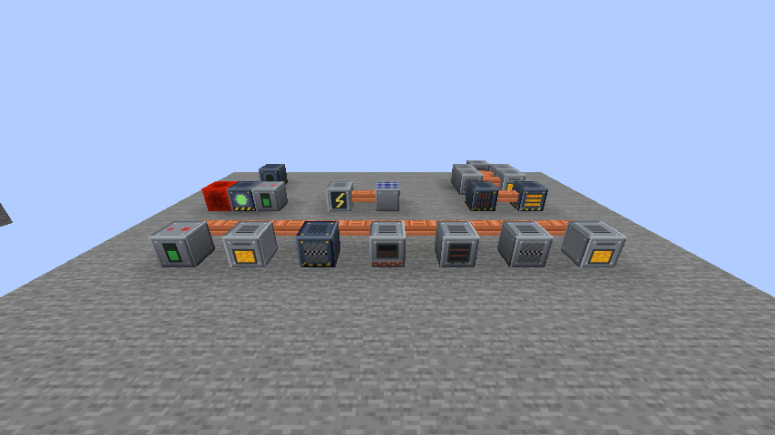

# Voltworks Industrial

An industrial tech mod for Minecraft **26.3** (Fabric). Generate power, run it through copper cables, and process ores with powered machines — up to a nuclear reactor.



## Features

**Power** (measured in J)
- **Generator** — burns furnace fuel, 10 J/t (one coal = 4,000 J). **Solar Panel** — 1 J/t in daylight. **Thermal Generator** — 5 J/t per adjacent lava source.
- **Reactor Chamber** — 3×3 grid of Fuel Rods (Refined Uranium + lead) and Heat Vents; needs a redstone signal; adjacent rods give more power *and* heat; pauses when its buffer is full; melts down at 100% heat. A comparator reads its heat.
- **Copper Cable** carries power. **Batteries**: Small 25,000 J (128 J/t) · Medium 100,000 J (512 J/t) · Large 1,000,000 J (2,048 J/t) · Huge 10,000,000 J (8,192 J/t). Power goes to machines first, then batteries.

**Machines**
- Tier 1: **Crusher** (ore → 2 dust), **Electric Furnace**, **Alloy Smelter** (iron + 2 coal → steel).
- Tier 2: **Industrial Crusher** (3 dust per ore, 4× speed), **Induction Furnace** (2 lanes, 4× speed).
- **Uranium Refiner** (tier 2) — uranium can't be smelted or crushed; the refiner enriches Raw Uranium (or uranium ore) into **Refined Uranium** for fuel rods (16 J/t, 300 ticks each), and reprocesses a spent fuel rod into one Refined Uranium.
- **Upgrades** (3 slots per machine): Speed, Capacity, Ejector (auto-outputs into adjacent inventories/machines).

**Logistics**
- **Item Pipes** — clear glass pipes linking chests, hoppers and machines; you can watch the items travel through them. Pipes pull finished items out of machines into chests automatically (machine outputs never go into other machines this way, so nothing loops). To pull from a chest, sneak + right-click that arm with the wrench to set it to Extract (striped collar); items go to the nearest inventory with room.
  - **Item Pipe** (tin) 4 items/s · **Fast Item Pipe** (steel, red rims) 16 items/s · **Express Item Pipe** (gold, gold rims) 64 items/s and near-instant travel. The pipe touching the source sets the pull rate.
  - **Filter Pipe** (purple) — right-click to set up to 9 items and Allow / Deny. Only matching items pass through it, so a chest behind one only receives those.
- **Wrench** — rotate blocks, set each machine side to None / Input / Output / Both, right-click a pipe arm to connect / disconnect it, sneak + right-click a pipe arm on an inventory to toggle Extract, and sneak + right-click other Voltworks blocks to pick them up.
- **Voltworks Guide** — in-game book (book + copper ingot) explaining everything; pages live in `tools/guide.txt`.
- Machines show their charge on a front gauge.

**Computer Storage**
- **Silicon** (Alloy Smelter: 2 sand + coal, or quartz + coal) → **Silicon Chips**.
- **Hard Drives** — Small 1K, Medium 4K, Large 16K, Huge 64K items, up to 63 kinds each. Contents stay on the drive when you take it out.
- **Drive Rack** — 8 drives; needs power (1 J/t + 1 per drive). **Data Cable** links racks, terminals and crafters (touching works too). Expand by adding drives, bigger drives or more racks.
- **Storage Terminal** — search and browse everything stored; click to take, shift-click to your inventory, click holding an item (or shift-click from your inventory) to store.
- **Computer Crafter** — set a 3×3 pattern from the storage list and craft x1 / x8 / x64 straight from storage; results go back in.

**Tools** — Electric Drill, Chainsaw (fells whole trees; sneak to cut one log), Advanced Drill (sneak + right-click for 3×3 mining). Run on energy, recharge in the **Charger**.

**Ores** — Tin, Lead (raw ores, dusts, ingots, storage blocks) and Uranium (raw ore, refined in the Uranium Refiner); `c:` convention tags.

## Building and running

Requires JDK 25 (the path is set in `gradle.properties` via `org.gradle.java.home` — change it if your JDK lives elsewhere).

```bash
./gradlew build            # jar in build/libs/
./gradlew runClient        # dev client with the mod
./gradlew runClientGameTest  # automated in-world test (see below)
```

To play: put `build/libs/voltworks-<version>.jar` and Fabric API in your `mods` folder.

## Automated test

`src/gametest/.../VoltworksClientGameTest.java` launches the game, creates a normal world (fixed seed), builds every machine setup, runs 700 ticks, and checks the results: machine outputs, power flow, battery charging, ore generation, loot tables, tool tiers, 3×3 drilling, upgrades, item pipes (tiers, filters, items in flight), the wrench, a safe reactor, an unpowered reactor, an idle reactor that saves fuel and a deliberate meltdown. It also saves screenshots to `build/run/clientGameTest/screenshots/`.

## Assets

Textures, models, recipes, loot tables, tags, worldgen and translations are generated by `tools/GenAssets.java`:

```bash
java tools/GenAssets.java src/main/resources
java tools/GenIcon.java .
```

All art is original: ores sit on procedurally generated stone and deepslate. (You *can* pass the Minecraft client jar as a second argument to draw ores over vanilla stone instead, but released builds don't, so no Mojang textures ship in the jar.) `GenIcon` draws the mod icon and the 400×400 CurseForge logo.


## Publishing

See [docs/curseforge.md](docs/curseforge.md) for the CurseForge project settings, upload fields, changelog and page description.

## License

MIT — see [LICENSE](LICENSE).
