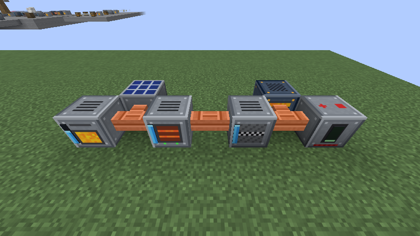
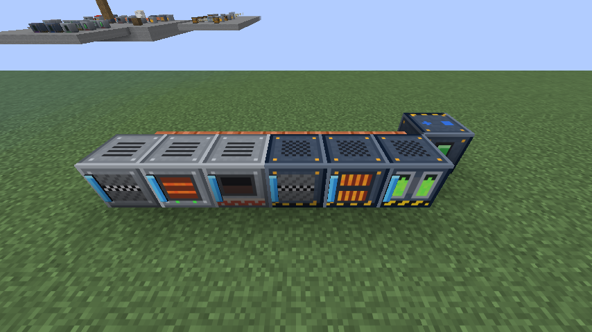
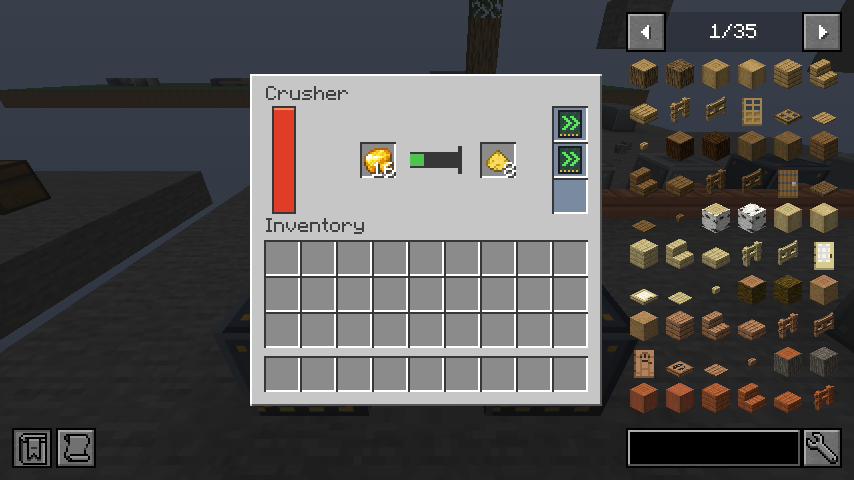
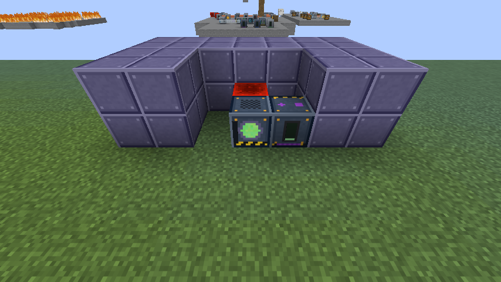
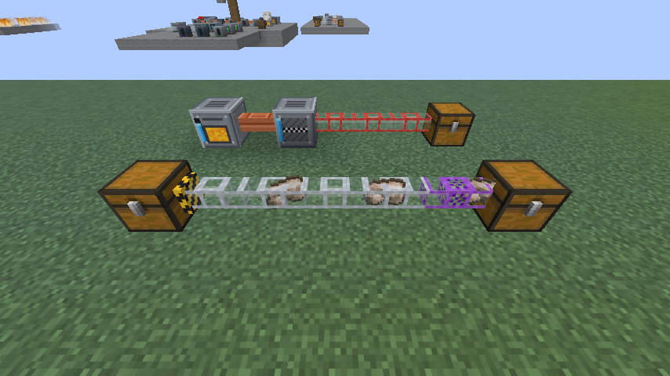
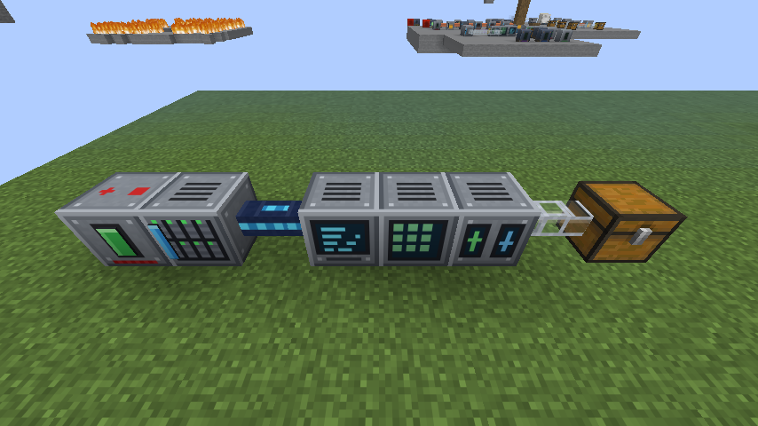
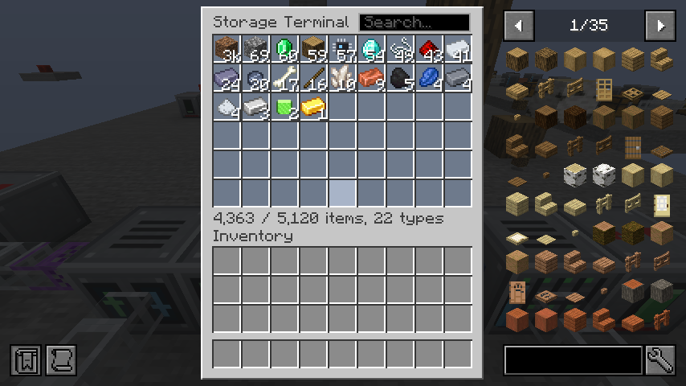
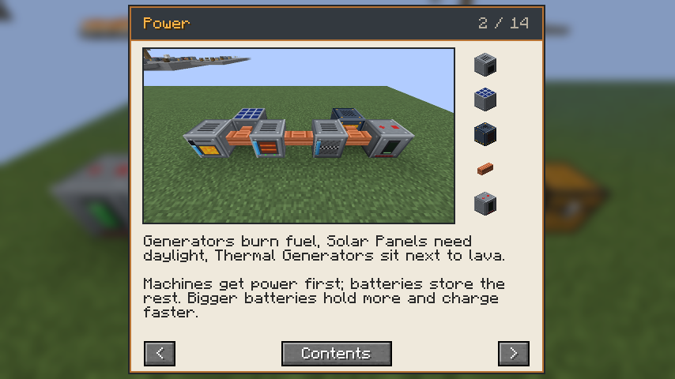

# CurseForge release kit (Voltworks Industrial)

Everything needed to create the Voltworks project and upload the first file. Copy the fields below into the CurseForge author console.

## Project settings

| Field | Value |
|---|---|
| Name | Voltworks Industrial |
| Summary (one line) | Industrial tech: power networks, ore crushers, item pipes, computer storage, power tools and a nuclear reactor. |
| Game / type | Minecraft / Mods |
| Main category | Technology |
| Extra categories | Energy, Ore Processing |
| License | MIT License |
| Logo | `docs/images/logo.png` (400×400) |
| Screenshots (Images tab) | From `docs/images/`: `power.png`, `machines.png`, `reactor.png`, `pipes.png`, `storage.png`, `crusher-gui.png`, `storage-terminal.png`, `guide-book.png` |
| Source link | https://github.com/chrisbrady86/voltworks-industrial |
| Issues link | https://github.com/chrisbrady86/voltworks-industrial/issues |

The description below shows these same pictures straight from the GitHub repo (`raw.githubusercontent.com/.../main/docs/images/...`), so they appear once the images are pushed to GitHub.

## First file upload

| Field | Value |
|---|---|
| File | `build/libs/voltworks-0.2.0.jar` (not the `-sources` jar) |
| Display name | Voltworks Industrial 0.2.0 |
| Release type | Beta |
| Game version | 26.3 |
| Mod loader | Fabric |
| Java version | Java 25 |
| Environment | Client and Server |
| Related projects | **Fabric API** — Required Dependency · **JEI** — Optional Dependency |
| Changelog | See below |

Version 0.2.0 is the first public upload. (0.1.0 was the private test build that ran on the author's server; worlds from it load in 0.2.0 unchanged.)

### Changelog for 0.2.0

```
First public release.
- Power: Generator, Solar Panel, Thermal Generator, Reactor Chamber; Copper Cable; Small, Medium, Large and Huge Batteries
- Machines: Crusher, Electric Furnace, Alloy Smelter, Industrial Crusher, Induction Furnace, Uranium Refiner
- Machine upgrades: Speed, Capacity, Ejector
- Nuclear: Fuel Rods, Heat Vents, meltdowns contained by Lead Blocks; /gamerule voltworks:reactor_meltdown destructive|contained|off
- Power tools: Electric Drill, Chainsaw (fells whole trees), Advanced Drill (3x3 mode), Charger
- Steel tools: Sword, Pickaxe, Axe, Shovel, Hoe and Spear, between iron and diamond
- Logistics: glass Item Pipes in three speeds (watch the items travel), Filter Pipe, Wrench. Pipes laid from a chest pull from it by themselves
- Computer storage: Hard Drives (1K-64K), Drive Rack, Data Cable, searchable Storage Terminal, Computer Crafter, Storage Interface (pipe access to storage)
- Chunk Loader: keeps the 3x3 chunks around it running
- Voltworks Guide: in-game book with pictures of example builds; addons can add pages
- New ores: Tin, Lead, Uranium
- JEI support (recipe pages, Computer Crafter recipe transfer); works with modded woods, leaves and sands (e.g. Biomes O' Plenty)
```

## Project description (paste into the description editor, Markdown mode)

```markdown
# Voltworks Industrial

**Build a power grid, automate your ore processing, and run a nuclear reactor — without blowing up your base. (Probably.)**

Voltworks Industrial is a tech mod for Fabric. Generate power, carry it through copper cables, and feed it to machines that double (or triple) your ore output.



## ⚡ Power
- **Generator** — burns any furnace fuel for 10 J/t (one coal = 4,000 J), including modded logs and planks.
- **Solar Panel** — free power in daylight.
- **Thermal Generator** — sits next to lava source blocks: 5 J/t per source, up to 25 J/t.
- **Reactor Chamber** — the big one. See below.
- **Copper Cable** connects everything; **Batteries** come in four sizes, from 40,000 J to 10,000,000 J. Machines get power first, batteries get the surplus.

## 🏭 Machines
| Machine | What it does |
|---|---|
| Crusher | Ore or raw ore → 2 dust (smelt dust into ingots: double output) |
| Electric Furnace | Smelts anything, 2× furnace speed |
| Alloy Smelter | Iron + 2 coal → **Steel**. Also makes netherite. |
| Industrial Crusher | 3 dust per ore, 4× faster |
| Induction Furnace | Two independent lanes, each 4× furnace speed |
| Uranium Refiner | Raw Uranium → Refined Uranium for fuel rods; reprocesses spent rods |





Every machine has **3 upgrade slots**:
- **Speed Upgrade** — 30% faster each (uses more power)
- **Capacity Upgrade** — +4,000 J internal storage each
- **Ejector Upgrade** — pushes finished items into the next machine or chest. Put a Crusher next to an Electric Furnace and ore turns into ingots by itself.

## ☢️ Nuclear reactor
The Reactor Chamber has a 3×3 grid for **Fuel Rods** and **Heat Vents**.
- Each rod pulses once, **plus once for every rod beside it** — clusters make far more power… and far more heat.
- Heat Vents cool more when placed next to rods; water around the reactor helps too.
- It only runs with a **redstone signal**, and a **comparator** reads its heat — build an automatic shutdown!
- Let it reach 100% heat and it **melts down**. Spectacularly. Two layers of **Lead Blocks** contain the blast.
- Server admins choose what a meltdown does: `/gamerule voltworks:reactor_meltdown destructive|contained|off`.



## 📦 Item pipes
- Clear glass **Item Pipes** — watch the items travel. Three speeds: tin, steel and gold.
- Machines empty into chests by themselves. Start a line at a chest and it pulls from that chest automatically.
- **Filter Pipes** sort items; the **Wrench** connects, disconnects and switches pipe arms.



## 💾 Computer storage
**Hard Drives** in a powered **Drive Rack**, a searchable **Storage Terminal**, a **Computer Crafter** that crafts straight from storage, and a **Storage Interface** so pipes can reach it all.





## ⛏️ Tools
- **Electric Drill** — pickaxe + shovel, faster than diamond.
- **Chainsaw** — cuts wood and leaves, and fells a whole tree from one cut (sneak to cut a single log).
- **Advanced Drill** — diamond tier with a **3×3 mining mode** (sneak + right-click).
- Power tools never break: recharge them in the **Charger**.
- **Steel tools** — sword, pickaxe, axe, shovel, hoe and spear, between iron and diamond.

## 🗺️ And more
- **Chunk Loader** keeps your factory running while you're away.
- The **Voltworks Guide** explains everything in-game, with pictures of example builds.
- **JEI** shows every machine recipe (optional).
- Works with modded woods, leaves and sands, such as Biomes O' Plenty's.



## 🪨 New ores
**Tin** (mid-depth), **Lead** (deep) and **Uranium** (very deep, faintly glowing). All work with the Crusher for double output, and use common `c:` tags for compatibility with other mods.

## Requirements
- Minecraft 26.3
- Fabric Loader
- [Fabric API](https://www.curseforge.com/minecraft/mc-mods/fabric-api)
- Optional: [JEI](https://www.curseforge.com/minecraft/mc-mods/jei)

Modpacks: yes, go ahead! Voltworks Industrial is MIT licensed.
```

## Before you click upload

- [ ] `./gradlew build` and grab the fresh jar from `build/libs/`
- [x] Name: "Voltworks" was taken on CurseForge, so the project is "Voltworks Industrial"
- [ ] Test the jar once in a normal Minecraft install (Fabric Loader + Fabric API) to be sure it loads outside the dev environment
- [ ] Back up the server world, then replace the 0.1.0 jar on the server with 0.2.0 (same block and item IDs; uranium changes only affect new chunks)
